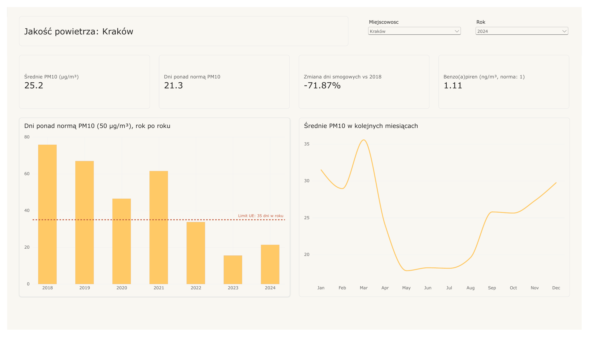
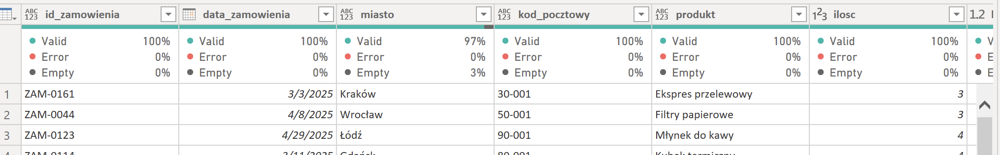
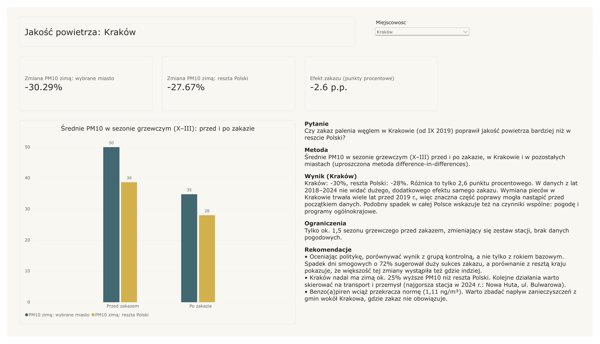

# Power Query Cleaner

[](https://github.com/MarKurzeja/power-query-cleaner/actions/workflows/ci.yml)

**Python (pandas, Streamlit) · Power Query (M) · Power BI · DAX**

A data preparation project in two parts:

- **Part A:** a Streamlit app that profiles a messy CSV or Excel file, proposes a cleaning plan and generates ready-to-use Power Query (M) code. Built for Polish data formats: Windows-1250 encoding, decimal commas, `dd.mm.yyyy` dates, NIP tax IDs and spelling variants (`Kraków` / `krakow` / `KRAKÓW`). The interface is in English and Polish.
- **Part B:** a Power BI dashboard on **~960,000 daily air quality measurements from 296 GIOŚ stations (2018–2024)**, prepared with the app.



---

## Part A – Power Query Cleaner app

**Problem:** files exported from Polish systems break in Power BI: garbled characters, amounts loaded as text, dates in three formats, the same city spelled four ways. Fixing this by hand in Power Query for every new file is slow and error-prone.

**How it works**
1. **Upload** a CSV or Excel file. Encoding and separator are detected automatically.
2. **Quality report:** detected type, missing values, unique counts and issues for every column.
3. **Cleaning plan:** suggested steps with checkboxes and a before/after preview.
4. **Power Query code:** paste it into Power BI (*Get data → Blank query → Advanced Editor*). From then on, every new version of the file is cleaned on refresh.

| Issue detected | Example | Generated fix |
| --- | --- | --- |
| Windows-1250 encoding, `;` separator | `Krak�w` | correct `Encoding=1250` in `Csv.Document` |
| Decimal comma, space as thousands separator | `1 234,56` | conversion with `pl-PL` culture |
| Dates in several formats | `05.03.2025`, `2025-03-06`, `07/03/2025` | one `date` column |
| Spelling variants | `Kraków` / `krakow` / `KRAKÓW` | mapped to the most frequent spelling |
| Missing values written as words | `brak`, `-`, `n/a` | replaced with `null` |
| NIP format and check digit | `526-025-02-74`, `PL5260250274` | digits only; invalid numbers reported |
| Wide layout with a multi-row header | one column per station | `Table.UnpivotOtherColumns` |
| Codes missing from a dictionary | renamed station codes | old codes mapped to current ones |
| Duplicates, outliers | an order for 400 items | duplicates removed; outliers reported, never removed |

**Validation:** the generated code runs in Power BI Desktop with **0% errors** in *Column quality*, and each step appears as a named step in *Applied Steps* ([screenshot](images/powerquery_applied_steps.png)). CI re-runs the automated tests on every push.



**Design decisions**
- **Rules, not a black box.** Profiling and cleaning are plain, deterministic Python rules, so every step can be explained.
- **Everything is read as text first.** pandas would otherwise guess types and could silently corrupt data (e.g. strip leading zeros).
- **One step, two implementations.** Each step exists in pandas (for the preview) and in M (for Power BI), so the preview matches the Power BI result.
- **The analyst decides.** Outliers are reported but never removed automatically.

## Part B – Air quality in Polish cities (GIOŚ, 2018–2024)

Source: [GIOŚ measurement archives](https://powietrze.gios.gov.pl/pjp/archives) (Chief Inspectorate of Environmental Protection). The full report is in [`powerbi/smog_dashboard.pbix`](powerbi/smog_dashboard.pbix), with all pages also as a [PDF](powerbi/smog_dashboard.pdf).

- **Preparing the data.** GIOŚ publishes wide files with several header rows and one column per station; the app unpivots them into one row per date and station. In the 2019 PM10 file, **16 of 179 station codes** are missing from the current metadata: 6 can be matched through the old-code column and 10 cannot be matched at all. Without this check those measurements would silently disappear when filtering by city.
- **Days above the PM10 daily limit in Kraków fell from ~76 (2018) to ~21 (2024), -72%.** Since 2022 Kraków has stayed below the EU limit of 35 days per year.
- **But the national average fell by a similar proportion**, and many cities improved even more (Elbląg -95%, Warszawa -89%, Katowice -81%).
- **Air quality follows the heating season:** monthly PM10 is roughly twice as high in winter as in summer.

### Did Kraków's coal ban work?



**Method:** average PM10 in the heating season (October–March) before and after the ban (September 2019), in Kraków and in all other cities – a simplified *difference-in-differences* design with the rest of Poland as the control group.

| Heating-season PM10 (µg/m³) | Before the ban | After the ban | Change |
| --- | --- | --- | --- |
| Kraków | 50 | 35 | **-30%** |
| Rest of Poland | 39 | 28 | **-28%** |
| **Estimated effect of the ban** | | | **≈ -2.6 percentage points** |

**Interpretation:** Kraków improved only slightly more than the rest of the country, so the 2018–2024 data shows no large additional effect of the ban itself. Kraków had been replacing coal stoves for years before 2019, and the similar drop across Poland points to common factors (weather, nationwide programmes). Limitations: only ~1.5 heating seasons before the ban, a changing set of stations, no weather data.

**Recommendations**
- **Evaluate policies against a control group, not only a base year.** The 72% drop in smog days looked like a big success of the ban, but most of that change happened elsewhere too.
- **Kraków still has ~25% higher winter PM10 than the rest of Poland.** Further action could target transport and industry – the worst station in 2024 was ul. Bulwarowa in Nowa Huta, the industrial district.
- **Benzo(a)pyrene is still above the 1 ng/m³ target (1.11 ng/m³ in 2024).** Pollution drifting in from municipalities around Kraków, where the ban does not apply, is worth investigating.

Other pages: [city vs national average](images/dashboard_vs_poland.png) · [station map](images/dashboard_map.png) · [data quality](images/dashboard_data_quality.png)

**Data model:** star schema with `Pomiary` (measurements) as the fact table and `Stacje` (stations) and `Kalendarz` (date table) as dimensions. One Power Query function (`fnGios`) loads every yearly file from a folder, unpivots it and maps old station codes to current ones. Comparisons return blank when a year has no data, so closed stations do not show a false "-100%".

## Skills demonstrated

| Area | Techniques |
| --- | --- |
| Python | pandas, Streamlit, regex-based type detection, encoding and separator detection, unpivoting wide files, pytest |
| Power Query (M) | code generation, culture-aware type conversion (`pl-PL`), `Table.UnpivotOtherColumns`, record-based lookups, a folder-loading function |
| Data quality | column profiling, IQR outliers, NIP checksum, spelling-variant normalisation, dictionary (lookup) checks |
| Power BI | star schema, DAX (`AVERAGEX`, `CALCULATE` + `REMOVEFILTERS`, `SELECTEDVALUE`), slicers, dynamic titles |
| Analytics | difference-in-differences, seasonality, benchmarking against a national average |

## How to run

```bash
python3 -m venv .venv && source .venv/bin/activate
pip install -r requirements.txt

python run.py app        # opens the Streamlit app in your browser
python run.py generate   # creates the messy sample file data/orders_messy.csv
python run.py test       # runs the automated tests
python run.py check      # what CI runs: generate the sample data, then run the tests
```

For Part B, download the yearly archives from [powietrze.gios.gov.pl/pjp/archives](https://powietrze.gios.gov.pl/pjp/archives), unzip them and place the `PM10_24g`, `PM25_24g` and `BaP(PM10)_24g` files plus the station metadata in `real_data/gios/`. Then open `powerbi/smog_dashboard.pbix`.

**Known limitations:** dates with slashes are read as day/month/year (US-style month/day is not supported), and wide-layout detection works for Excel files whose first column contains dates.

## Structure

```
python/     Streamlit app, profiling, cleaning + M code generation, sample data generator
tests/      automated tests (pytest)
data/       messy sample file (synthetic)
real_data/  raw GIOŚ files (downloaded, not in the repository)
powerbi/    dashboards + PDF export
images/     screenshots used in this README
run.py      single entry point for all workflows
.github/    CI workflow
```

---

**Maria Kurzeja** · [GitHub](https://github.com/MarKurzeja) · MIT licence (air quality data: GIOŚ)
